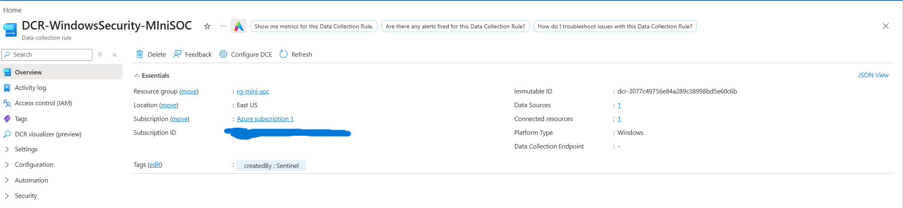
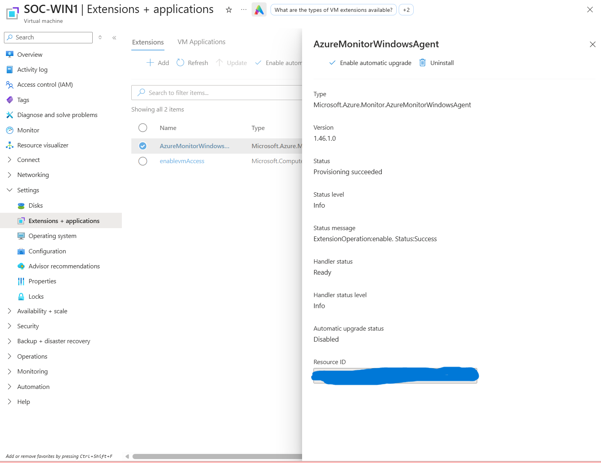
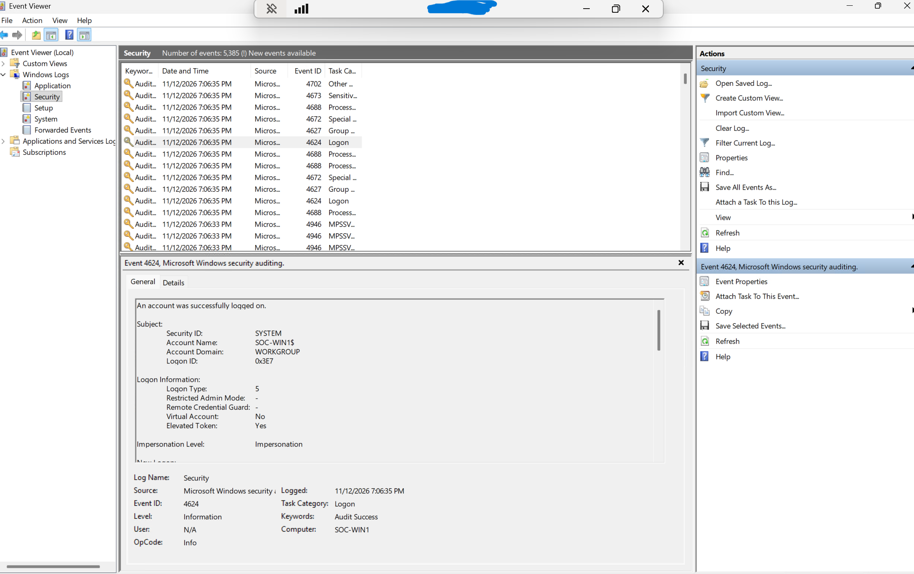
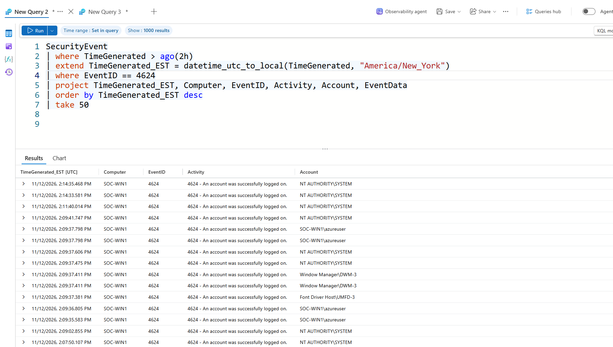
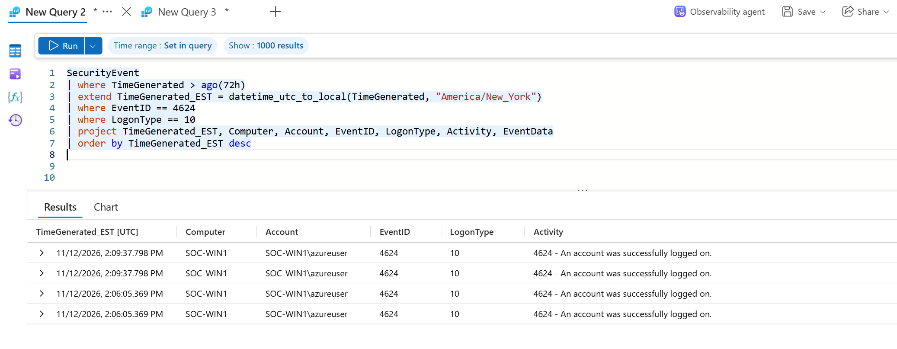

# azure-home-soc

## Windows Security Event Collection and Analysis

### Objective

Configure centralized security log collection from an Azure-hosted Windows Server virtual machine 'SOC-WIN1' into Microsoft Sentinel. Validate the collection pipeline using Kusto Query Language (KQL) and investigate Windows authentication events.

### 1.1 — Configuring the Data Collection Rule (DCR)

Created a Data Collection Rule named `DCR-WindowsSecurity-MiniSOC` within the `rg-mini-soc` resource group.

The DCR defines the Windows Security Events collected from the virtual machine and directs them to the associated Log Analytics workspace, `law-mini-soc`.

The configuration shows one connected resource and one data source, establishing the foundation for centralized security log collection.

 

### 1.2 — Deploying the Azure Monitor Agent (AMA)

Verified the successful deployment of the Azure Monitor Agent on `SOC-WIN1`.

The Azure Monitor Agent collects Windows Security Events according to the associated Data Collection Rule and forwards them to the Log Analytics workspace.

Confirmed that the agent was running version `1.46.1.0`, with a provisioning status of **Succeeded** and handler status of **Ready**.

 

### 1.3 — Inspecting Windows Security Events

Accessed Windows Event Viewer on `SOC-WIN1` and navigated to **Windows Logs → Security** to examine security events generated by the operating system.

Observed several security event types, including:

- **Event ID 4624:** Successful account logon
- **Event ID 4688:** New process creation
- **Event ID 4702:** Scheduled task modification
- **Event ID 4672:** Special privileges assigned to a new logon

This confirmed that the Windows Server VM was generating security audit events that could be collected for centralized analysis.

### 1.4 — Querying Windows Security Events in Microsoft Sentinel

Used Kusto Query Language (KQL) to query the `SecurityEvent` table in Microsoft Sentinel.

Filtered for Event ID 4624 to examine successful authentication events collected from `SOC-WIN1`.

The query returned authentication activity associated with the local administrator account (`SOC-WIN1\azureuser`) and Windows system accounts, including `NT AUTHORITY\SYSTEM`.

This demonstrated successful ingestion of Windows authentication events and the ability to investigate individual security records through Microsoft Sentinel.

### 1.5 — Verifying Remote Desktop Authentication

Established Remote Desktop Protocol (RDP) sessions with `SOC-WIN1` to generate successful remote authentication events.

Executed a KQL query filtering for:

- **Event ID 4624:** Successful account logon
- **LogonType 10:** RemoteInteractive authentication, commonly associated with RDP

The query returned successful remote logon events for `SOC-WIN1\azureuser`, confirming that RDP authentication activity was being collected and made available for analysis in Microsoft Sentinel.

This validation demonstrated the ability to isolate a specific authentication method from broader Windows Security Event data.

### Step 1 Outcome

Successfully configured and validated a centralized Windows Security Event collection pipeline using Microsoft Sentinel, Azure Monitor Agent, Data Collection Rules, and Log Analytics.

Verified the collection of real Windows security events and demonstrated the ability to query and investigate authentication activity using KQL.

**Technical skills demonstrated:** Microsoft Sentinel, Azure Monitor Agent, Data Collection Rules, Windows Event Viewer, Log Analytics, Kusto Query Language (KQL), SIEM monitoring, and Windows authentication analysis.
